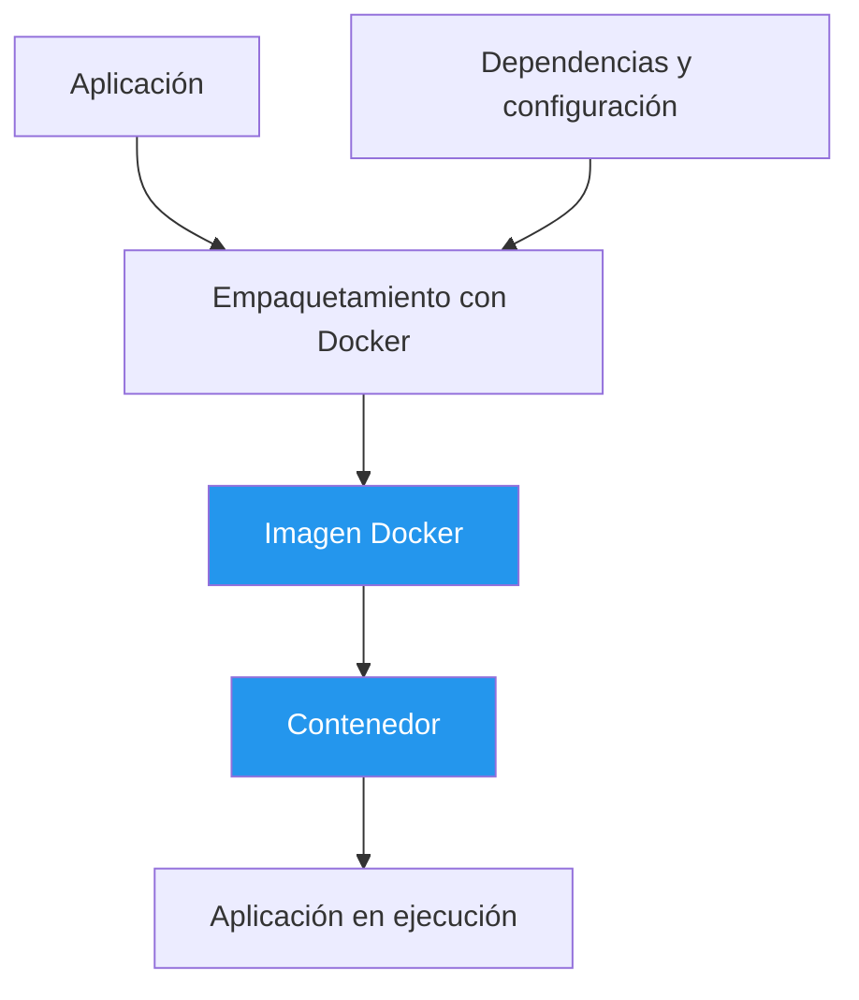
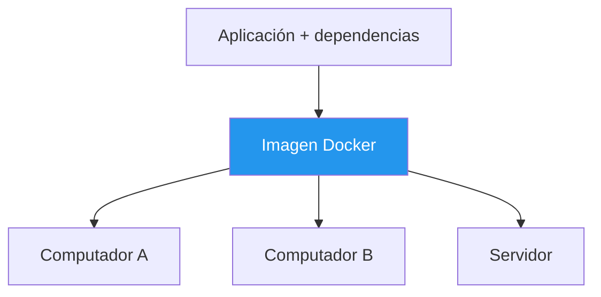

# 🐳 1. ¿Qué es Docker?

## 📌 Definición

**Docker** es una plataforma que permite empaquetar y ejecutar aplicaciones dentro de **contenedores**, incluyendo sus dependencias y configuraciones necesarias para funcionar.

Su propósito es facilitar la ejecución de aplicaciones en diferentes entornos de manera consistente.

## 🎯 ¿Para qué se utiliza?

- **Desarrollo:** preparar entornos con dependencias específicas.
- **Bases de datos:** ejecutar PostgreSQL, MySQL o Redis.
- **Microservicios:** separar una aplicación en servicios independientes.
- **Pruebas:** crear entornos controlados.
- **Despliegue:** ejecutar aplicaciones en distintos servidores.

## ⚙️ ¿Cómo funciona?

Docker permite empaquetar una aplicación y sus dependencias en una imagen. A partir de ella se crean contenedores donde se ejecuta la aplicación.

## 💡 ¿Qué problema resuelve?

Evita muchos problemas causados por diferencias entre los entornos donde se ejecuta una aplicación.

Esto ayuda a evitar el conocido problema:

> "En mi computador funciona, pero en el tuyo no".

## ⭐ Características principales

| Característica | Descripción |
|---|---|
| Portabilidad | Facilita trasladar aplicaciones entre entornos compatibles. |
| Aislamiento | Separa la ejecución de las aplicaciones. |
| Eficiencia | Comparte el kernel del sistema operativo anfitrión. |
| Reproducibilidad | Mantiene entornos de ejecución consistentes. |
| Escalabilidad | Facilita ejecutar múltiples instancias. |

## 📚 Referencias

- [Docker Documentation – What is Docker?](https://docs.docker.com/get-started/docker-overview/)
- [Docker Documentation – Get started](https://docs.docker.com/get-started/)