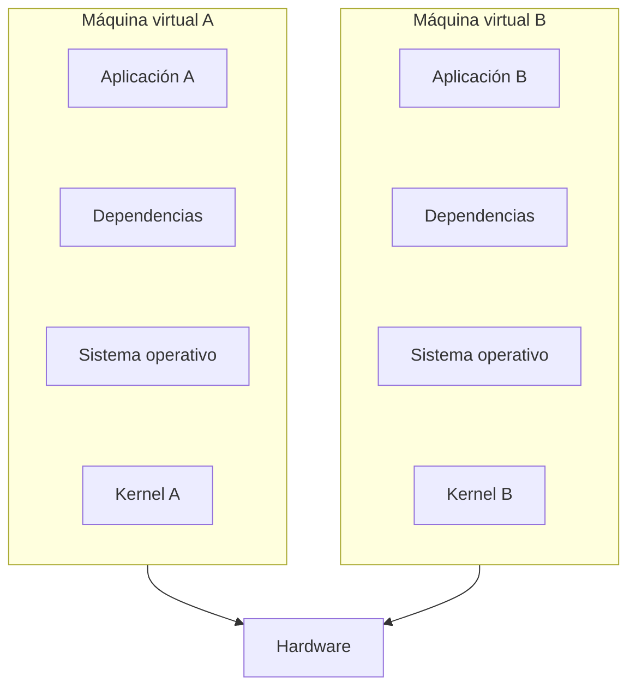
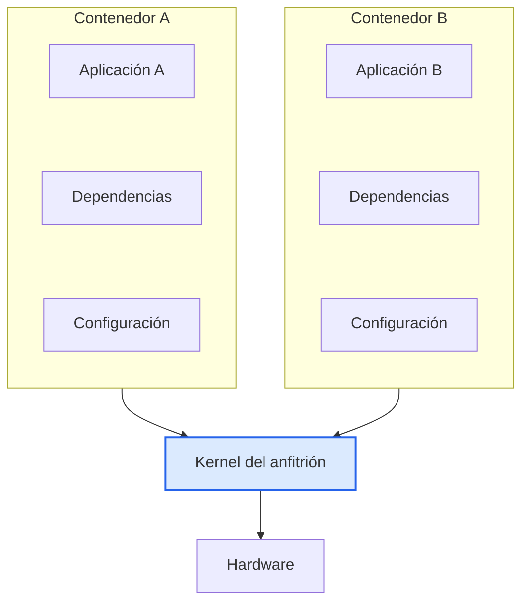

# 1.2 Contenedores vs. Máquinas Virtuales

## 🐳 ¿Qué es un contenedor?

Un contenedor es un entorno aislado que reúne **lo necesario para que una aplicación funcione**: la aplicación, sus dependencias, bibliotecas y configuraciones.

En lugar de tener un sistema operativo completo, utiliza el kernel del sistema operativo anfitrión.

## ⚙️ ¿Cómo funciona?

Docker permite ejecutar aplicaciones en contenedores independientes. Cada uno tiene sus propios procesos y recursos aislados, pero todos pueden compartir el mismo kernel.

## 🔍 Diferencia principal

**Máquinas virtuales:** cada una necesita su propio sistema operativo.

**Contenedores:** contienen lo necesario para ejecutar la aplicación y comparten el kernel del sistema operativo anfitrión.

## 📊 Comparación visual

### Máquinas virtuales

### Contenedores

## 💡 ¿Por qué utilizar contenedores?

- **Menor consumo:** no necesitan un sistema operativo completo por aplicación.
- **Rapidez:** suelen iniciarse más rápido que las máquinas virtuales.
- **Aislamiento:** cada aplicación funciona en su propio entorno controlado.

> **En resumen:** una máquina virtual necesita un sistema operativo completo; un contenedor reúne lo justo y necesario para que una aplicación funcione, aprovechando el kernel del sistema anfitrión.