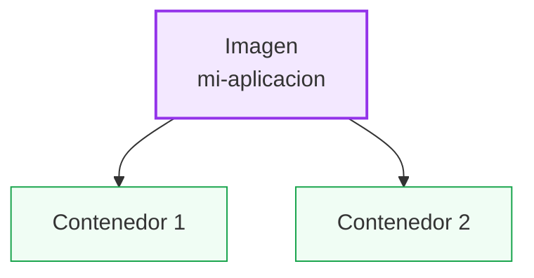
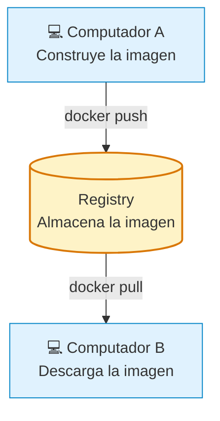
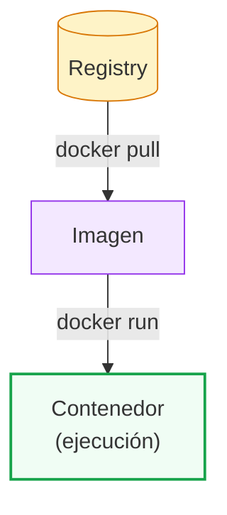

# 🐳 1.4 — Imágenes, contenedores y registros

## 📦 1. Imágenes Docker

Una **imagen Docker** es una plantilla que contiene todo lo necesario para ejecutar una aplicación.

Puede incluir:
- Sistema base o entorno de ejecución (Python, Node.js, etc.).
- Librerías y dependencias.
- Código de la aplicación.
- Configuraciones necesarias.

**Ejemplo:**

```dockerfile
FROM python:3.12

WORKDIR /app
COPY app.py .
CMD ["python", "app.py"]
```

`FROM` indica la imagen base que se utilizará para construir nuestra imagen.

**Características:**
- Son inmutables: no se modifican directamente una vez construidas.
- Se pueden reutilizar para crear múltiples contenedores.
- Se almacenan localmente o en un Registry.

## 📦 2. Contenedores

Un **contenedor** es una instancia de una imagen Docker. Proporciona un entorno aislado donde se ejecuta una aplicación.

Una misma imagen puede generar varios contenedores independientes.



**Características:**
- Ejecutan procesos dentro de un entorno aislado.
- Tienen una capa propia donde se registran los cambios.
- Pueden iniciarse, detenerse y eliminarse.
- Al detenerlos, no desaparecen automáticamente.

### Comandos principales

| Comando | Función |
|---|---|
| `docker run` | Crea e inicia un contenedor |
| `docker ps` | Muestra contenedores activos |
| `docker ps -a` | Muestra todos los contenedores |
| `docker stop` | Detiene un contenedor |
| `docker start` | Inicia un contenedor detenido |
| `docker rm` | Elimina un contenedor |

## 🌐 3. Registries (registros)

Un **Registry** es un servicio que permite almacenar, administrar y distribuir imágenes Docker.

Ejemplos:
- Docker Hub.
- GitHub Container Registry (GHCR).
- Amazon Elastic Container Registry (ECR).

### ¿Cómo funciona?



### Comandos principales

| Comando | Función |
|---|---|
| `docker pull` | Descarga una imagen |
| `docker push` | Sube una imagen |
| `docker login` | Inicia sesión en un Registry |
| `docker logout` | Cierra la sesión |

## 🔄 4. Relación entre los conceptos

Los tres conceptos forman parte del flujo de trabajo de Docker:


- **Imagen:** plantilla de la aplicación.
- **Contenedor:** instancia creada a partir de una imagen.
- **Registry:** servicio que almacena y distribuye imágenes.

